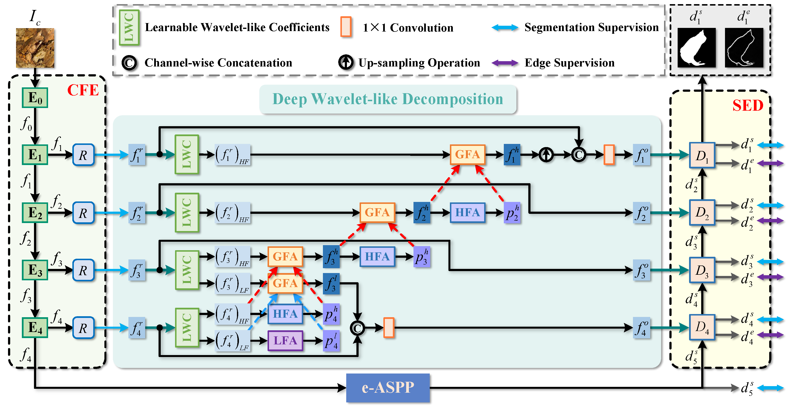

# FEDER
**Camouflaged Object Detection with Feature Decomposition and Edge Reconstruction**,  CVPR 2023

[[Paper](https://openaccess.thecvf.com/content/CVPR2023/papers/He_Camouflaged_Object_Detection_With_Feature_Decomposition_and_Edge_Reconstruction_CVPR_2023_paper.pdf)] [[Supplementary material](https://openaccess.thecvf.com/content/CVPR2023/supplemental/He_Camouflaged_Object_Detection_CVPR_2023_supplemental.pdf)] [[Results](https://drive.google.com/drive/folders/1Pho42bHiBhVR0l9KzdOFQgqLzr8mSv9e?usp=sharing)] [[Pretrained models](https://drive.google.com/file/d/1MONpM9auqGlRoyaOKUe6wJgLZ-E6A4Dc/view?usp=sharing)]

#### Authors
[Chunming He](https://chunminghe.github.io/), [Kai Li*](http://kailigo.github.io/), [Yachao Zhang](https://yachao-zhang.github.io/), Longxiang Tang, [Yulun Zhang](https://yulunzhang.com/), [Zhenhua Guo](https://scholar.google.com/citations?user=dbR6bD0AAAAJ&hl=en), [Xiu Li*](https://scholar.google.com/citations?user=Xrh1OIUAAAAJ&hl=en)

---
> **Abstract:** *Camouflaged object detection (COD) aims to address the tough issue of identifying camouflaged objects visually blended into the surrounding backgrounds. COD is a challenging task due to the intrinsic similarity of camouflaged objects with the background, as well as their ambiguous boundaries. Existing approaches to this problem have developed various techniques to mimic the human visual system. Albeit effective in many cases, these methods still struggle when camouflaged objects are so deceptive to the vision system. In this paper, we propose the FEature Decomposition and Edge Reconstruction (FEDER) model for COD. The FEDER model addresses the intrinsic similarity of foreground and background by decomposing the features into different frequency bands using learnable wavelets. It then focuses on the most informative bands to mine subtle cues that differentiate foreground and background. To achieve this, a frequency attention module and a guidance-based feature aggregation module are developed. To combat the ambiguous boundary problem, we propose to learn an auxiliary edge reconstruction task alongside the COD task. We design an ordinary differential equation-inspired edge reconstruction module that generates exact edges. By learning the auxiliary task in conjunction with the COD task, the FEDER model can generate precise prediction maps with accurate object boundaries. Experiments show that our FEDER model significantly outperforms state-of-the-art methods with cheaper computational and memory costs.*
>
> <p align="center">
> 
> </p>
---

## Usage

### 1. Prerequisites

> Note that FEDER is only tested on Ubuntu OS with the following environments.

- Creating a virtual environment in terminal: `conda create -n FEDER python=3.8`.
- Installing necessary packages: `pip install -r requirements.txt`

### 2. Downloading Training and Testing Datasets

- Download the [training set](https://anu365-my.sharepoint.com/:u:/g/personal/u7248002_anu_edu_au/EQ75AD2A5ClIgqNv6yvstSwBQ1jJNC6DNbk8HISuxPV9QA?e=UhHKSD) (COD10K-train) used for training 
- Download the [testing sets](https://anu365-my.sharepoint.com/:u:/g/personal/u7248002_anu_edu_au/EVI0Bjs7k_VIvz4HmSVV9egBo48vjwX7pvx7deXBtooBYg?e=FjGqZZ) (COD10K-test + CAMO-test + CHAMELEON + NC4K ) used for testing

### 3. Training Configuration

- The pretrained model is stored in [Google Drive](https://drive.google.com/file/d/1OmE2vEegPPTB1JZpj2SPA6BQnXqiuD1U/view?usp=share_link). After downloading, please change the file path in the corresponding code.
```bash
python Train.py  --epoch 160  --lr 1e-4  --batchsize 36  --trainsize 36  --train_root YOUR_TRAININGSETPATH  --val_root  YOUR_VALIDATIONSETPATH  --save_path YOUR_CHECKPOINTPATH
```

### 4. Testing Configuration

Our well-trained model is stored in [Google Drive](https://drive.google.com/file/d/1MONpM9auqGlRoyaOKUe6wJgLZ-E6A4Dc/view?usp=sharing). After downloading, please change the file path in the corresponding code.
```bash
python Test.py  --testsize YOUR_IMAGESIZE  --pth_path YOUR_CHECKPOINTPATH  --test_dataset_path  YOUR_TESTINGSETPATH
```

### 5. Evaluation

- Matlab code: One-key evaluation is written in [MATLAB code](https://github.com/DengPingFan/CODToolbox), please follow this the instructions in `main.m` and just run it to generate the evaluation results.

### 6. Results download

The prediction results of our FEDER are stored on [Google Drive](https://drive.google.com/drive/folders/1Pho42bHiBhVR0l9KzdOFQgqLzr8mSv9e?usp=sharing) please check.

## Related Works
[Weakly-Supervised Concealed Object Segmentation with SAM-based Pseudo Labeling and Multi-scale Feature Grouping](https://arxiv.org/abs/2305.11003), arxiv 2023.

[Feature Shrinkage Pyramid for Camouflaged Object Detection with Transformers](https://github.com/ZhouHuang23/FSPNet), CVPR 2023.

[Concealed Object Detection](https://github.com/GewelsJI/SINet-V2), TPAMI 2022.

You can see more related papers in [awesome-COD](https://github.com/visionxiang/awesome-camouflaged-object-detection).
## Citation
If you find our work useful in your research, please consider citing:
```
@inproceedings{He2023Camouflaged,
title={Camouflaged Object Detection with Feature Decomposition and Edge Reconstruction},
author={He, Chunming and Li, Kai and Zhang, Yachao and Tang, Longxiang and Zhang, Yulun and Guo, Zhenhua and Li, Xiu},
booktitle={IEEE Conference on Computer Vision and Pattern Recognition (CVPR)},
year={2023}
}
```

## Concat
If you have any questions, please feel free to contact me via email at chunminghe19990224@gmail.com or hcm21@mails.tsinghua.edu.cn.

## Acknowledgement
The code is built on [SINet V2](https://github.com/GewelsJI/SINet-V2). Please also follow the corresponding licenses. Thanks for the awesome work.

---

# Fork notes (CSD361 extension)

This fork adds three research extensions behind config flags, plus the fixes
needed to run the released code at all. `scripts/README.md` is the runbook;
this section is the map.

## Running the released model

Defaults reproduce FEDER exactly (`bands=2`, fixed Haar), so old checkpoints
still load:

```bash
python -m pip install -r requirements-pip.txt     # NOT requirements.txt (see below)
python tools/verify_data.py --root data/USEDATA --strict
python tests/test_wavelet.py
bash scripts/p1_01_sweep.sh
```

## What the flags do

| flag | question it answers |
|---|---|
| `--bands K --learnable_wavelet` | **RQ1** — does a finer, learnable frequency decomposition help? |
| `--band_weight none\|static\|adaptive` | **RQ1** — per-band adaptive weighting of the K bands. |
| `--edge_feed kband` / `--ablate_mid` | **RQ3** — should the edge module see the mid bands? |
| `--gf_radius` | resolution/cost study (changes the architecture — hold it fixed within a comparison) |

## New modules and tools

- `lib/WaveletKBand.py` — learnable K-band decomposition. Lifting steps make it
  exactly invertible for any filter values, and it is numerically identical to
  the released Haar DWT at initialisation, so the K=2 row *is* the baseline.
- `lib/ModulesK.py` — `GCM3K` (band-wise aggregation for any K) and mid-band
  fusion for RQ3.
  MoCHi hard-negative mixing.
- `lib/config.py` — one definition of the model flags, shared by every entry
  point. Training writes `config.json` beside its checkpoints and the tools
  read it back, so a checkpoint is always scored with the architecture that
  produced it.
- `tools/benchmark.py` — predict, score (S-α, F-w-β, E-φ, MAE, boundary-F) and
  append a row to `results/results.csv` in one command.
- `tools/band_report.py` — the per-band weights a trained model learned.
- `tools/val_curve.py` — compares runs by mean-of-last-N validations, and says
  when a gap is inside the noise.
- `tools/measure_cost.py` — parameters, FLOPs, latency and peak memory, which
  the paper reports only as a scatter plot.
- `tests/test_wavelet.py` — 11 tests covering invertibility, Haar equivalence,
  DC-freeness of the mid bands, and the resolution floor.

## Upstream problems fixed here

- **Encoder was randomly initialised.** `Network.py` shipped
  `timm.create_model(..., pretrained=False)`; nothing else loaded a backbone,
  so the released configuration cannot reproduce the paper. Now `pretrained=True`.
- **`requirements.txt` is not installable.** It is a conda explicit spec list;
  pip rejects lines like `_libgcc_mutex=0.1=main` (issue #8). Use
  `requirements-pip.txt`.
- **Single-GPU training crashed.** `--gpu_id` defaulted to `'4,5'` while
  `device_ids` was hardcoded to `[0, 1]`. Device ids are now derived from what
  is actually visible.
- **`--load` restored weights only**, so an interrupted run restarted its
  optimizer and LR schedule. `--resume` now restores model, optimizer, scaler,
  epoch and the best-so-far metric.
- **Resuming could overwrite the best checkpoint.** `last.pth` was written
  before validation and the main block reset `best_mae` after the checkpoint
  restored it, so the first validation after a resume always looked like an
  improvement. Both are fixed; this matters because free-tier session limits
  force multi-session training.
- **`Test.py` could not load current checkpoints** (`torch.load(...).items()`
  assumed a bare state_dict) and hardcoded GPU `'1'`.
- **Odd input sizes broke the DWT** (issues #4, #9). The lifting transform
  pads to even and crops on inverse.

## The resolution floor — read before planning GPU time

**256 does not work, and 384 is the minimum.** `AGF` builds a guided filter of
radius 2 whose `h_lrx > 2r+1` assertion requires the coarsest band to exceed
5 px; at 256 input that band is 4 px. Only **384, 448 and 512** run at the
published radius — 320 fails the radius check and 416 produces an odd
intermediate. This is a property of the *released* architecture, not of this
extension.

So a cheaper protocol must reduce **epochs**, not resolution. If you genuinely
need 256, pass `--gf_radius 1` and hold it fixed across every row of the
comparison, because it changes the architecture.

## Measured cost (RTX 3050, 384 px, batch 1)

| K | params | GFLOPs | latency | peak mem |
|---|---|---|---|---|
| 2 | 43.5 M | 35.9 | 166 ms | 415 MiB |
| 3 | 43.8 M | 36.0 | 189 ms | 589 MiB |
| 4 | 44.1 M | 36.0 | 222 ms | 426 MiB |
| 6 | 44.8 M | 36.2 | 261 ms | 600 MiB |

K barely moves FLOPs but costs real latency: each band adds its own sequential
guided-filter aggregation path, which is memory-bound rather than FLOP-bound.
Worth stating explicitly if you claim a K>2 result is cheap.
